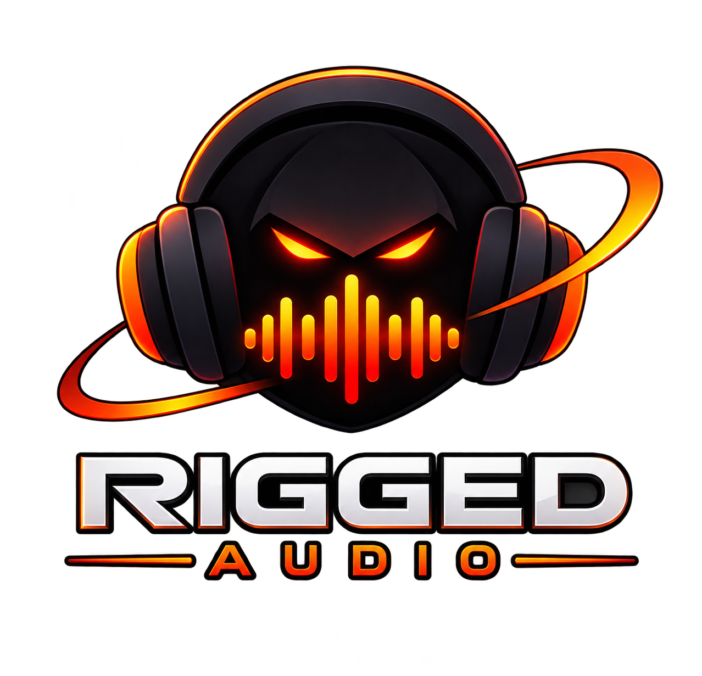
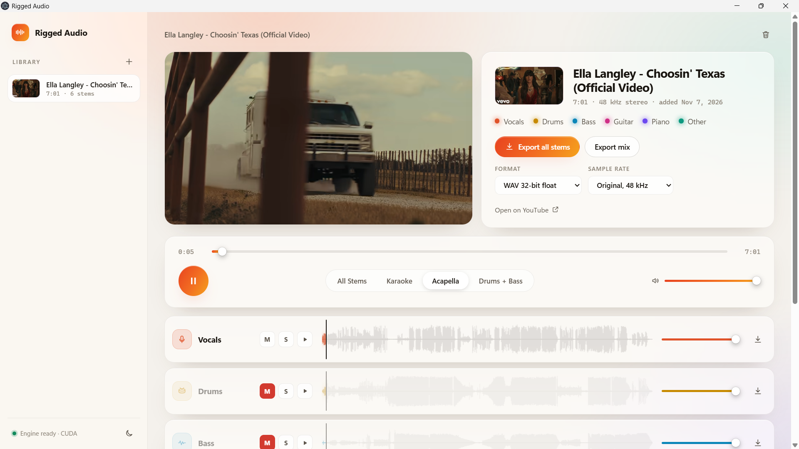
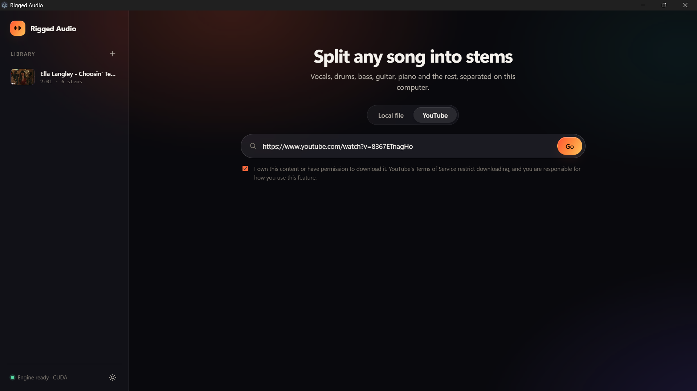

<p align="center">
  
</p>

<h1 align="center">Rigged Audio</h1>

<p align="center">
  Split any song into vocals, drums, bass, guitar, piano and the rest, on your own computer.<br />
  Free and open source. No account, no subscription, no uploads.
</p>

<p align="center">
  <a href="https://github.com/DrunkTrader/rigged_audio/releases"><b>Download</b></a> ·
  <a href="docs/QUICK_START.md"><b>Quick start</b></a> ·
  <a href="CONTRIBUTING.md"><b>Contributing</b></a>
</p>



## Features

- **Six stems** with the open-source [Demucs](https://github.com/adefossez/demucs) AI model, on your GPU if you have one, otherwise the CPU
- **Mixer:** waveforms, mute, solo and volume per stem, plus one-click Karaoke, Acapella and Drums + Bass presets
- **Export** single stems, all stems or your mix as high-quality WAV
- **Import** MP3, WAV, FLAC, M4A, OGG and more, or search YouTube and watch the video in sync with your mix
- **Private:** after a one-time setup, everything runs offline on your computer
- Dark and light themes, keyboard shortcuts, Windows, macOS and Linux



## Get started

1. [Download](https://github.com/DrunkTrader/rigged_audio/releases) the installer for Windows, macOS or Linux.
2. Open the app. The first launch downloads the AI engine once (about 1–3 GB).
3. Drop in a song and choose **Separate into 6 stems**.

The installers are not code-signed yet, so Windows and macOS show a warning the first time. The [Quick start](docs/QUICK_START.md) explains how to continue, plus system requirements, YouTube, privacy and where your data lives.

## Run from source

```bash
git clone https://github.com/DrunkTrader/rigged_audio.git
cd rigged_audio
npm install
npm run dev
```

Requires Node.js 22+. See [CONTRIBUTING.md](CONTRIBUTING.md) for the project layout and checks, and [docs/RELEASING.md](docs/RELEASING.md) for building installers.

## License

[GNU General Public License v3.0](LICENSE). Separation is powered by [Demucs](https://github.com/adefossez/demucs) (MIT) and [PyTorch](https://pytorch.org), set up with [uv](https://github.com/astral-sh/uv); YouTube support uses [yt-dlp](https://github.com/yt-dlp/yt-dlp) and [FFmpeg](https://ffmpeg.org). These are downloaded at first launch under their own licenses, not bundled in the installer.

## Star History

<a href="https://www.star-history.com/?repos=drunktrader%2Frigged_audio&type=date&legend=top-left">
 <picture>
   <source media="(prefers-color-scheme: dark)" srcset="https://api.star-history.com/chart?repos=drunktrader/rigged_audio&type=date&theme=dark&legend=top-left" />
   <source media="(prefers-color-scheme: light)" srcset="https://api.star-history.com/chart?repos=drunktrader/rigged_audio&type=date&legend=top-left" />
   
 </picture>
</a>
