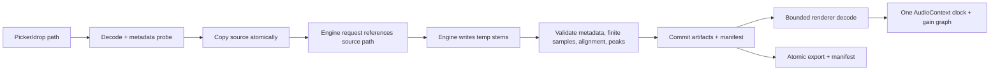

# Audio pipeline

The first slice accepts PCM WAV. The real decoder adapter will use FFmpeg or a native library selected per platform, but conversion is explicit in metadata. All stems from one request share the source sample rate and frame count unless the engine declares and the validator corrects a known latency/offset.

Playback creates one source node per stem at the same `AudioContext` start time. The context clock is authoritative; seeking stops and recreates all sources at one offset. The real-time callback is owned by the browser/native audio subsystem and does no inference, allocation, or disk I/O. Long-file streaming and peak-cache rendering are release requirements before claiming unlimited library scale.

Validation checks RIFF structure, channel/sample-rate/frame metadata, finite sample values, peak level, silence, and duration alignment. Clipping is reported, never silently normalized.
