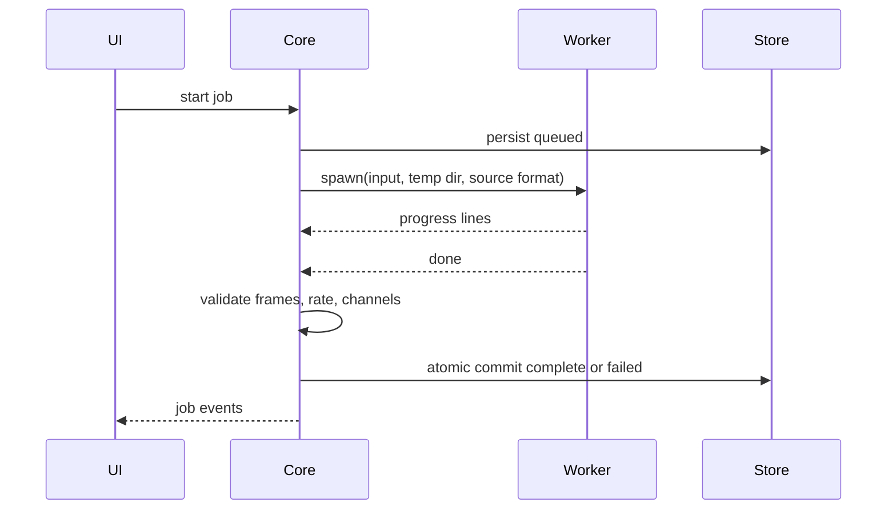

# Model runtime

## Engine

`DemucsEngine` (`src/core/engine.ts`) implements `SeparationEngine` and runs `python/worker.py separate` as a child process, one per job. Cancel is a process kill. The worker exits when the app dies (stdin EOF on macOS and Linux, a wait on `--parent-pid` on Windows), so a force-killed app does not leave it running.

Model: Demucs `htdemucs_6s` from `demucs==4.1.0` (MIT). It is the only maintained, permissively licensed option found that gives all six stems from one model. Its piano stem is reported as its weakest. BS-RoFormer scores higher on guitar in third-party tests, but no licence was found for a six-stem checkpoint, so it is not used. A different model only needs a new engine and worker command.

## Worker protocol

Arguments: `separate --input <wav> --output <dir> --rate <hz> --channels <n> --frames <n>`.

Stdout is one JSON object per line:

```json
{ "kind": "progress", "progress": 42, "message": "Separating stems" }
{ "kind": "warning", "message": "cuda failed, using CPU: ..." }
{ "kind": "done", "stems": ["drums", "bass", "other", "vocals", "guitar", "piano"], "device": "cpu" }
{ "kind": "error", "message": "..." }
```

Audio moves by file path only. Stems are written as 32-bit float WAV at the source sample rate, channel count and exact frame count. The service validates each one against the source before committing.



## First-run setup

`RuntimeManager` (`src/core/runtime.ts`) installs everything into `<data>/runtime`, needing no system Python:

1. Download `uv` from GitHub, verified against a SHA-256 pinned in source. Update `UV_VERSION` and `UV_BUILDS` together.
2. `uv venv` with a uv-managed Python 3.12.
3. `uv pip install --torch-backend=auto`, which picks the CUDA, ROCm or CPU PyTorch wheel, plus Demucs, `imageio-ffmpeg` and yt-dlp. `sphn` is excluded (see below).
4. `worker.py prefetch` downloads the weights to `<data>/runtime/hf`. Weights are safetensors, so loading them cannot execute code.
5. `worker.py probe` reports the device, then `runtime.json` is written atomically. That file is the ready marker, so an interrupted setup restarts cleanly.

After setup, inference runs with `HF_HUB_OFFLINE=1`. Verified by running a full separation with every socket call blocked.

## Why `sphn` is excluded

`demucs` 4.1 depends on `sphn`, which has no wheels for Intel macOS or Linux arm64. Only `demucs/api.py` imports it. The worker uses `demucs.pretrained` and `demucs.apply` with ffmpeg for I/O, so one install path works on every platform. `numpy` is listed explicitly because it otherwise arrives through `sphn`.

## Devices

`pick_device` chooses CUDA (also true on ROCm builds), then MPS, then CPU. A runtime error on a GPU retries the job on CPU.
