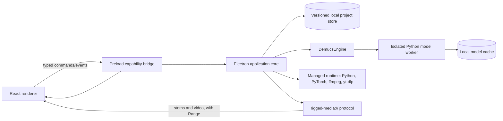

# System overview

## Components

The renderer owns presentation state only. The core owns paths, job lifecycle, persistence, validation, and worker launch. Engines never call UI code. The worker receives a bounded request referencing a project input path and writes to a job-owned temporary directory.

## Boundaries

- Renderer: accessible UI, transport gestures, mix state, Web Audio graph within an explicit memory budget.
- Preload: allow-listed, typed methods; no arbitrary IPC channel or filesystem method.
- Core: schema validation, safe path resolution, atomic writes, scheduler, correlation IDs.
- Engine: stable `SeparationEngine` contract and output validator.
- Worker: model-specific inference only; no access to the renderer and no arbitrary command execution.
- Store: durable project/job records and artifact manifests, independent of an in-memory queue.
